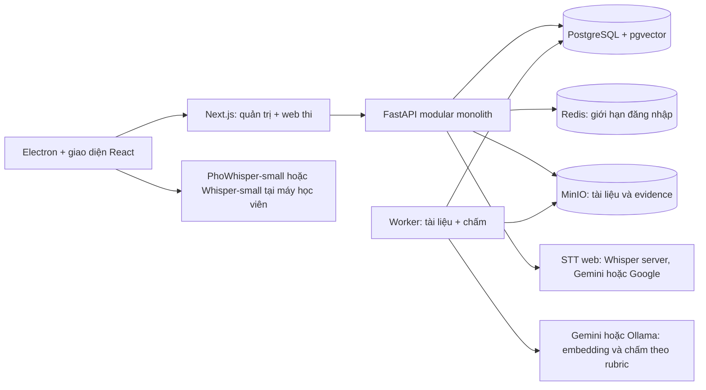

# Tổng quan kiến trúc hệ thống

[README / danh mục tài liệu](../../README.md#hướng-dẫn-theo-nhu-cầu)

Hệ thống tổ chức luồng tài liệu → rubric → đề thi → trả lời bằng giọng nói → STT → RAG và chấm điểm → lưu minh chứng → giảng viên xem lại. Web và desktop dùng chung giao diện Next.js, kết nối API FastAPI và các dịch vụ dữ liệu.

## Các thành phần chức năng

1. **Nền tảng:** monorepo, PostgreSQL/pgvector, MinIO, Redis, migration, JWT và phân quyền.
2. **Dữ liệu môn học:** môn học, LO, chủ đề; nhập PDF/PPTX/DOCX/TXT, tách văn bản theo trang/slide/nhóm đoạn, tạo embedding.
3. **Thiết kế đề:** rubric nhiều tiêu chí có trọng số, blueprint chủ đề/độ khó/số câu. Quy trình khảo thí gồm sinh đề theo RAG, giảng viên review và duyệt, khảo thí xếp lịch và mở thi.
4. **Thực hiện bài thi:** giao bài theo sinh viên, kết nối thiết bị, ghi audio/video từng câu, nhận dạng và kiểm tra transcript, tải minh chứng và nộp bài.
5. **Đánh giá:** worker truy xuất đúng môn/chủ đề/tập tài liệu đã công bố, kiểm tra JSON từ AI, tính điểm server và confidence gate.
6. **Đối chiếu:** giảng viên xem transcript, điểm tiêu chí, tài liệu RAG và audio/video; nhập điểm chính thức cùng nhận xét cho bài cần chấm lại.

## Kiến trúc triển khai

Worker là process riêng dùng chung code backend. Job nằm trong trạng thái bản ghi PostgreSQL; worker dùng `FOR UPDATE SKIP LOCKED`. Crash trước commit khiến transaction rollback, công việc được lấy lại. SQLite phục vụ phát triển với một worker; PostgreSQL phục vụ triển khai nhiều người dùng.

Giao diện source chạy tại `http://localhost:3001`, có bộ chọn backend **Local / Online**. Local kết nối server `http://localhost:3000`; Online mặc định kết nối `https://oral-test.paperlens.uk`. Phiên đăng nhập tách riêng theo backend. Xem [kết nối web và desktop](accounts-courses-desktop.md#kết-nối-backend-trên-web-local-và-desktop).

## Quy tắc xử lý

- **Web và desktop:** Electron dùng `contextIsolation=true`, `sandbox=true`, `nodeIntegration=false`. IPC kiểm tra renderer và origin cho phép trước khi xử lý STT, đăng nhập Google hoặc thoát ứng dụng.
- **STT desktop:** nhận dạng audio gốc bằng PhoWhisper-small hoặc Whisper-small CPU INT8. Học viên chọn model và tiếng Việt/tiếng Anh trên thiết bị, kiểm tra transcript trước khi nộp.
- **STT web:** dùng provider và ngôn ngữ theo cấu hình server. Trình duyệt có gain microphone, thu thử 10 giây và tùy chọn RNNoise; mặc định nhận dạng bản gốc. Chi tiết tại [kiến thức và STT](knowledge-speech.md) và [luồng âm thanh](crud-noise-check.md).
- **AI:** Gemini và Ollama phục vụ embedding, sinh câu hỏi và chấm JSON theo rubric. Chế độ demo dùng hashing vector 768 chiều và câu hỏi mẫu để thử quy trình, kết quả không có điểm chính thức. Lỗi provider được trả về để xử lý.
- **Snapshot:** đề công bố cố định rubric, câu hỏi, nguồn kiến thức, provider, model, embedding, prompt version và hotword môn học. Cấu hình AI phải khớp snapshot khi thi và chấm; thay provider/model cần tài liệu và phiên bản đề phù hợp.
- **Upload minh chứng:** media được chia chunk, kiểm tra hash từng chunk và cả file, có retry ngắn. Hàng đợi upload nằm trong bộ nhớ client.
- **Điểm:** chuẩn hóa từng tiêu chí bằng `score / max_score`, nhân trọng số, chia tổng trọng số và quy về 10. Điểm AI của bài là trung bình điểm các câu. Bài thiếu điểm, có cờ cần xem lại hoặc điểm AI dưới 5 chuyển `REVIEW_REQUIRED`; điểm giảng viên duyệt được lưu riêng. LO weight là metadata; blueprint quyết định phân bổ số câu.
- **Hết giờ:** server chặn bắt đầu câu mới. Transcript của câu đã bắt đầu vẫn được tiếp nhận khi đến trễ, có đánh dấu cần xem lại. Câu còn trống được ghi nhận thiếu bài và cần review khi nộp.
- **Tài liệu:** tài liệu đã xử lý và nguồn trong snapshot được giữ bất biến. Giáo trình lỗi có thể thay PDF để worker xử lý lại. DOCX gộp nội dung và bảng với `page=1`; PDF scan cần OCR trước khi nhập.

## Phân quyền

| Vai trò | Phạm vi |
| --- | --- |
| ADMIN | Quản trị hệ thống, tài khoản, môn học và các bước tổ chức thi |
| EXAM_OFFICER | Tổ chức kỳ thi, phân công giảng viên, nhập danh sách sinh viên, xếp lịch, mở thi và xuất điểm |
| TEACHER | Quản lý môn phụ trách, soạn/duyệt đề và chấm lại bài của môn |
| REVIEWER | Xem môn học và kết quả để đối chiếu |
| STUDENT | Xem bài được giao, thi theo lịch và truy cập kết quả của chính mình |

Chi tiết tại [quy trình khảo thí](examination-workflow.md), [số lần làm bài](exam-retakes.md) và [độ tin cậy, chấm lại](grading-confidence.md).
