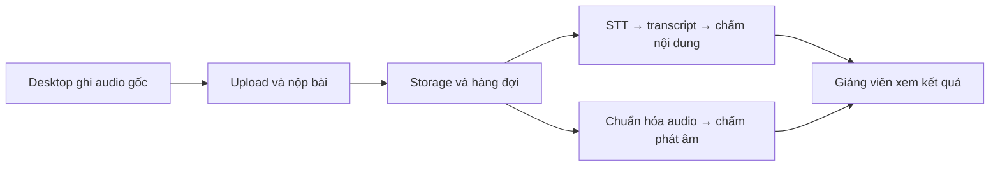

# Speaking Test — 6 môn ENT độc lập trên domain chính

Ngày cập nhật: **21/10/2026**. Đã thực hiện trên `https://oral-test.paperlens.uk`.

Đã thay môn gộp bằng **6 môn riêng: ENT001, ENT104, ENT203, ENT303, ENT403,
ENT503**. Mỗi môn có một bộ đề mẫu gồm hai phần, một rubric riêng, một chủ đề,
mô tả mục tiêu học tập và tài liệu riêng. Vào **Môn học** hoặc **Ngân hàng đề
thi** rồi chọn mã ENT tương ứng.

- **6 đề mẫu, 12 phần thi:** giữ nội dung PDF và thời lượng từng phần.
- **6 rubric độc lập:** mỗi môn có bản ghi/ID riêng, chỉnh sửa riêng. Nội dung
  ban đầu cùng lấy từ `Speaking Rubric.xlsx`: Ideas, Pronunciation, Grammar
  Range and Accuracy, Vocabulary Range and Accuracy, Fluency and coherence;
  mỗi tiêu chí 2 điểm, tổng 10 điểm. Giữ đủ bốn mức mô tả từ nguồn.
- **18 tài liệu READY:** mỗi môn có 1 PDF giáo trình, 1 TXT trích xuất/ghi chú
  và 1 TXT rubric. Đã so sánh checksum với nguồn và kiểm tra snapshot tham
  chiếu tài liệu của chính môn đó.
- **Đã xóa 3 môn cũ:** `IELTS4.0` (Speaking English), `SE102` (Speaking Test),
  `ENGLISH-ORAL-03` (Tiếng Anh giao tiếp — Vấn đáp 3 câu), cùng dữ liệu thi
  thuộc các môn này.
- **Đã xóa 2 lớp cũ:** `IELTS4.0-01` (Band 4.0), `SE1` (Test01), gồm các liên
  kết ghi danh của lớp. Tài khoản sinh viên và bộ môn được giữ lại.
- Đã đọc lại backend: còn đúng sáu môn ENT nêu trên, không còn môn/lớp cũ.
  Không tự tạo lớp mới hoặc ghi danh lại sinh viên.

Các đề giữ trạng thái **GENERATED — bản nháp chờ duyệt**. ENT203/303 vẫn cần
thi theo cặp; ảnh/thẻ vai cần giảng viên cung cấp từ PDF. Part 2 thảo luận
cho giảng viên chọn 1–2 trong 5 câu, không bắt trả lời tất cả. Khác biệt thời
lượng ENT001 giữa trang tổng quan và trang mẫu đã được ghi chú, nhập theo mẫu.
Rubric đánh giá toàn bộ phần thể hiện; điểm trung bình các câu của app không
thay thế điểm rubric tổng thể. Chấm phát âm và nhịp nói cần nghe audio.
Phương án Azure bên dưới vẫn là **đề xuất, chưa triển khai**.

Tài liệu: [cấu trúc và importer](data/ent-speaking/README.md),
[đối chiếu 6 môn mới](data/ent-speaking/import-report.json),
[biên bản xóa môn/lớp cũ](data/ent-speaking/migration-report.json),
[nội dung đề và nguồn rubric](data/ent-speaking/assessment.json).

---

# Đề xuất chấm phát âm tiếng Anh cho OralAI

Ngày khảo sát: **20/10/2026**. Trạng thái: **đề xuất để xem xét, chưa triển khai**.

## 1. Phương án đề xuất

Thử nghiệm **Azure Speech Pronunciation Assessment** làm nhà cung cấp đầu tiên; giữ thiết kế adapter để có thể thay bằng SpeechSuper/Speechace hoặc engine nội bộ sau này. Chấm trên server từ audio gốc đã upload, không thêm model vào desktop.

Lý do lựa chọn là mức phù hợp với kiến trúc hiện tại và khả năng trả kết quả chi tiết, chưa phải kết luận Azure chính xác nhất với sinh viên Việt Nam. Cần đối chiếu điểm với giảng viên trước khi đưa vào điểm chính thức.

Giai đoạn đầu chỉ hiển thị **điểm phát âm tham khảo**, tách khỏi điểm nội dung. Chọn một trong hai phạm vi thử nghiệm: bài đọc có văn bản chuẩn để kiểm chứng lỗi từng từ; hoặc bài vấn đáp tự do nếu muốn áp dụng ngay cho các đề hiện tại. Nên kiểm chứng bài đọc trước, sau đó mở rộng sang nói tự do.

## 2. Các lựa chọn

| Giải pháp | Khả năng và chi phí tham khảo | Mức phù hợp đề xuất |
| --- | --- | --- |
| **Azure Speech Pronunciation Assessment** | Có chấm đọc và nói tự do, độ chính xác phát âm, độ trôi chảy, chi tiết từ/âm vị; completeness dành cho bài có văn bản chuẩn. Prosody hiện hỗ trợ `en-US`. [Tài liệu Microsoft](https://learn.microsoft.com/en-us/azure/ai-services/speech-service/how-to-pronunciation-assessment). | Ưu tiên thử nghiệm; máy sinh viên không cần GPU/model bổ sung. |
| **SpeechSuper API** | Giá niêm yết pay-as-you-go: word **0,004 USD/request**, sentence **0,006**, paragraph **0,008**; unscripted Basic **0,030**, Pro **0,035**. Mức tối thiểu **20 USD/tháng**; unscripted trong giới hạn 2 phút theo bảng sản phẩm. [Bảng giá](https://www.speechsuper.com/pricing.html). | Phương án đối chứng, nhất là hoạt động đọc ngắn và nói tự do theo câu. |
| **Speechace API** | Basic **40 USD/tháng**, Pro **80**, Premium **125**. Giới hạn audio tương ứng **30 giây / 45 giây / 2 phút**; số đơn vị audio bao gồm và phí vượt mức khác nhau theo gói. [Bảng giá](https://www.speechace.com/api-plans/). | Đáng thử cho học ngoại ngữ; cần chọn đúng gói theo dạng bài và độ dài. |
| **GOP/Kaldi + GOPT, tự triển khai** | GOPT có mã nguồn và checkpoint; đầu vào là đặc trưng GOP, không nhận audio thô trực tiếp. Bản công khai dùng acoustic model Librispeech; pipeline suy luận audio mới cần xử lý Kaldi. Repo còn ghi nhận lỗi trong hướng dẫn inference cần giải quyết trước khi dùng. [Repo chính thức](https://github.com/YuanGongND/gopt). | Hướng NCKH/kiểm soát dữ liệu; cần công xây dựng, benchmark và hiệu chỉnh. |

Giá là thông tin tham khảo tại ngày khảo sát, không phải báo giá; cần kiểm tra lại khu vực, gói, thuế, quota và điều khoản trước khi mua. Chưa mở tài khoản, mua dịch vụ hoặc gửi audio sinh viên ra ngoài.

Azure tính phần chấm cơ bản theo giá Speech-to-Text Standard/commitment; prosody có phí bổ sung. Trang giá động chưa cung cấp được đơn giá cụ thể cho cấu hình khu vực/tài khoản của dự án, nên không ghi một mức USD/giờ cố định. [Cách tính phí](https://learn.microsoft.com/en-us/azure/ai-services/speech-service/pronunciation-assessment-tool), [bảng giá Azure](https://azure.microsoft.com/en-us/pricing/details/speech/).

Ví dụ ngân sách do dự án giả định: 100 sinh viên × 5 câu × 60 giây = **500 phút ≈ 8,33 giờ audio**, chưa tính thi lại/chấm lại. Với Azure, dùng số giờ được tính phí × đơn giá của khu vực + phần prosody nếu bật. Với SpeechSuper, 500 request unscripted Basic tính theo đơn giá là 15 USD; nếu áp dụng minimum và không có usage khác thì ngân sách tối thiểu vẫn là 20 USD/tháng. Cần xác minh giới hạn request và cách tính retry; không coi chia nhỏ audio là cách miễn phí vượt giới hạn dịch vụ.

## 3. Có model nhẹ chạy local không?

Có hướng tự xây dựng, nhưng chưa nên coi một checkpoint nhỏ là một hệ thống chấm phát âm hoàn chỉnh:

- **GOP + GOPT:** bộ chấm dùng đặc trưng âm học; toàn bộ dịch vụ còn gồm nhận dạng/căn chỉnh âm vị và trích đặc trưng. Kích thước riêng bộ chấm không đại diện RAM, dung lượng hay độ trễ toàn pipeline. Chưa benchmark trên phần cứng của dự án, nên chưa cam kết CPU realtime.
- **wav2vec2-base + head âm vị/chấm điểm:** là hướng nghiên cứu thay thế. Model gốc chỉ pretrain trên audio 16 kHz, cần fine-tune cho tác vụ, không có sẵn điểm phát âm dùng ngay. [Model card của Meta](https://huggingface.co/facebook/wav2vec2-base).
- Whisper-small đang có trong dự án tạo transcript. `stt_confidence` hiện là tín hiệu phục vụ luồng nhận dạng/review; không được đổi tên thành điểm phát âm. Chỉ từ transcript không thể xác định đầy đủ sinh viên phát âm âm cuối, trọng âm hay ngữ điệu ra sao.

Nếu mục tiêu là **desktop nhẹ**, gọi API từ server phù hợp hơn. Nếu mục tiêu là **không phụ thuộc dịch vụ ngoài**, nên thử engine nội bộ trên worker riêng trước khi tính đến đóng gói lên desktop.

## 4. Phân biệt dạng bài

| Dạng bài | Đầu vào đề xuất | Cách sử dụng kết quả |
| --- | --- | --- |
| **Đọc thành tiếng** | Audio + `reference_text` do giảng viên nhập, được chốt cùng câu hỏi | Đánh giá phát âm; đối chiếu đọc thiếu/thừa từ; hiển thị chi tiết từng từ nếu provider trả về. |
| **Nói tự do / vấn đáp** | Audio + locale; dùng chế độ unscripted | Đánh giá phát âm/trôi chảy/ngữ điệu. Nhánh nội dung vẫn chấm bằng transcript + rubric + RAG. |

Không dùng đáp án mẫu nội dung làm `reference_text` cho câu vấn đáp: sinh viên có thể trả lời đúng bằng cách diễn đạt khác. Nếu sau này dùng transcript ASR làm bản tham chiếu, phải lưu nguồn transcript, kiểm tra lỗi nhận dạng và xem đó là chế độ riêng; kết quả chịu ảnh hưởng của ASR.

Azure yêu cầu continuous mode khi audio dài hơn 30 giây; chế độ này không hỗ trợ trực tiếp `EnableMiscue`, nên đánh dấu thiếu/thừa từ cần đối chiếu riêng. Adapter phải xử lý độ dài và tổng hợp kết quả, không chỉ gọi nhận dạng một câu rồi bỏ phần còn lại. [Hướng dẫn SDK](https://learn.microsoft.com/en-us/azure/ai-services/speech-service/how-to-pronunciation-assessment).

## 5. Luồng tích hợp đề xuất

Hiện tại `services/api/app/processing.py` đã có worker lấy audio hoàn tất, kiểm tra checksum, nhận dạng và chấm nội dung. Mở rộng bằng nhánh tác vụ phát âm độc lập để lỗi/quota của nhà cung cấp không làm mất kết quả nội dung.

Thiết kế dự kiến:

- Dùng audio gốc đã kiểm tra checksum; tạo bản WAV PCM mono 16 kHz khi adapter yêu cầu. `audio_processing.prepare_audio(..., mode="off")` hiện hỗ trợ chuyển đổi này. Không mặc định dùng bản STT đã lọc nhiễu/chuẩn hóa âm lượng cho chấm phát âm; giữ bản gốc để đối chiếu.
- Thêm adapter `assess_pronunciation(audio, policy, reference_text)`; API key chỉ ở server. Chỉ bật một provider cho mỗi lần chấm chính; thử đối chứng hai provider là tác vụ pilot riêng có dự toán chi phí.
- Tác vụ có trạng thái `PENDING/RUNNING/COMPLETED/FAILED/NOT_APPLICABLE`, timeout, retry giới hạn và khóa chống chạy trùng. Khi mất response từ dịch vụ ngoài, không thể bảo đảm không bị tính tiền lại nếu provider không hỗ trợ idempotency; lưu request ID và giới hạn thử lại.
- Lưu provider, phiên bản engine nếu có, locale, mode, audio hash, nguồn/văn bản tham chiếu, cấu hình snapshot, thời điểm chấm, kết quả gốc và kết quả chuẩn hóa. Không ghi API key vào JSON/log.
- Kết quả chuẩn hóa gồm điểm tổng, accuracy, fluency, prosody, completeness khi áp dụng, từ/âm vị/timestamp nếu được trả về. Trường không hỗ trợ để `null`, không tự điền 0.
- Lượt chấm lại tạo bản kết quả có lịch sử; không âm thầm thay nhà cung cấp hoặc ghi đè điểm đã duyệt. Đồng bộ chính sách lưu/xóa audio với các job còn đang xử lý.

## 6. Cấu hình web admin và hiển thị kết quả

**Cấu hình hệ thống → Chấm phát âm** dự kiến có: bật/tắt, provider, region/endpoint hợp lệ, API key, locale, prosody, giới hạn độ dài, timeout và ngân sách/quota. Chỉ ADMIN cấu hình dịch vụ và bí mật.

Cấu hình đề/câu hỏi có: bật chấm phát âm, loại `READ_ALOUD` hoặc `UNSCRIPTED`, văn bản đọc nếu có, và chế độ `FEEDBACK_ONLY` hoặc `WEIGHTED`. Các thay đổi đi theo phân quyền soạn/duyệt đề hiện tại. Chốt policy khi tạo lượt thi; sửa cấu hình không đổi lượt đang làm hoặc điểm cũ.

Trong **Chi tiết bài thi**, thêm khối phát âm: điểm riêng, từ cần nghe lại, nút phát đoạn audio theo timestamp, trạng thái lỗi/chờ và thao tác chấm lại theo quyền. Lỗi rõ ràng cho audio không đủ điều kiện, ngôn ngữ không phù hợp, quá dài, hết quota hoặc timeout. Audio không đủ điều kiện phải chuyển review, không cho 0 điểm phát âm tự động.

Giai đoạn đầu giữ quy tắc desktop hiện tại: sinh viên chỉ nhận xác nhận nộp, giảng viên xem điểm. Nếu cần phản hồi trực tiếp cho sinh viên trong chế độ luyện tập, thiết kế thành phạm vi riêng.

## 7. Điểm số và thử nghiệm

Mặc định **FEEDBACK_ONLY**: điểm nội dung và điểm phát âm độc lập. Không tự quy đổi thành IELTS/TOEIC chính thức hoặc coi các provider có thang điểm tương đương.

Sau khi hiệu chỉnh, có thể cho từng đề cấu hình trọng số. Ví dụ minh họa, chưa áp dụng: `điểm cuối = 0,8 × điểm nội dung + 0,2 × điểm phát âm quy đổi về thang 10`. Chia điểm 0–100 cho 10 chỉ là đổi thang số, không chứng minh hai điểm đo cùng mức năng lực. Khi thành phần bắt buộc chưa có kết quả, giữ chờ/review thay vì tự đổi trọng số.

Đề xuất pilot **50–100 bản ghi** có sự đồng ý phù hợp, nhiều trình độ và điều kiện mic, gồm bài đọc và nói tự do; ít nhất hai giảng viên chấm độc lập theo rubric thống nhất. Đo mức phù hợp với giảng viên, sai lệch điểm, lỗi theo nhóm/giọng nói, khả năng chỉ đúng từ cần sửa, thời gian p50/p95 và chi phí mỗi bài. Tách tập hiệu chỉnh khỏi tập đánh giá, không chỉ chọn vài bản ghi nghe tốt để kết luận. Chốt tiêu chí chấp nhận với giảng viên trước khi dùng điểm chính thức.

Khi chọn dịch vụ ngoài, xác nhận vị trí xử lý, thời gian lưu audio và cơ chế xóa dữ liệu phù hợp với trường; thông báo mục đích gửi audio. Không gửi tên/email sinh viên nếu nhà cung cấp không cần.

## 8. Các bước dự kiến sau khi chốt phương án

- [ ] Chọn provider pilot, ngân sách và dạng bài cần ưu tiên.
- [ ] Chuẩn bị audio mẫu và rubric đối chiếu; thống nhất quyền sử dụng dữ liệu.
- [ ] Chạy thử adapter trên server, đo kết quả/chi phí trước khi ghép điểm.
- [ ] Bổ sung cấu hình admin, snapshot đề/lượt và migration lưu kết quả/job.
- [ ] Tích hợp hàng đợi, trạng thái lỗi/retry và lịch sử chấm lại.
- [ ] Thêm giao diện review phát âm; giữ điểm tham khảo trong pilot.
- [ ] Kiểm thử phân quyền, quota, thiếu audio, audio dài, không có lời nói, provider lỗi và không tính điểm sai khi thiếu kết quả.
- [ ] Giảng viên nghiệm thu rồi mới cân nhắc bật trọng số vào điểm cuối.

**Đề xuất chốt hiện tại:** Azure cho pilot, `en-US`, điểm tham khảo; bật prosody khi cần đánh giá ngữ điệu và ngân sách cho phép. Giữ SpeechSuper làm lựa chọn đối chứng; dành GOP/GOPT cho nhánh nghiên cứu local.
